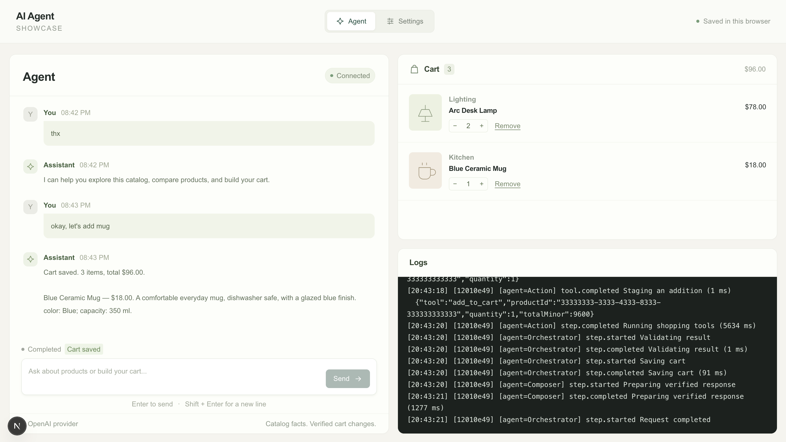
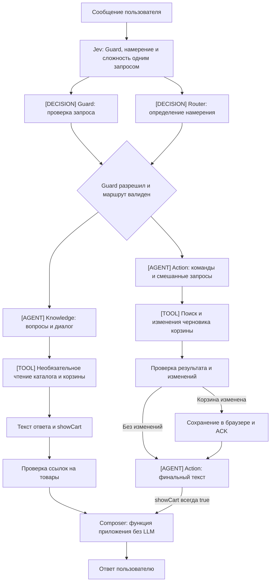
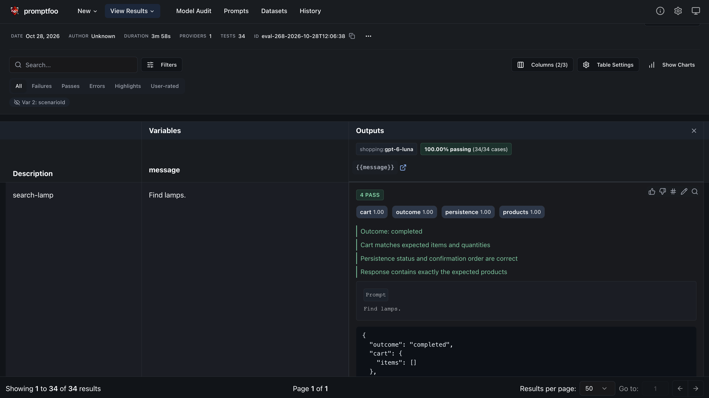

# AI Shopping Assistant

ИИ-ассистент для покупок: ищет товары в каталоге, отвечает на вопросы и управляет корзиной через диалог. Проект показывает полный цикл агентного приложения — от определения намерения и вызова инструментов до сохранения результата и проверки качества в Promptfoo.

В интерфейсе доступны чат, корзина и журнал выполнения с этапами обработки запроса и вызовами инструментов. На странице настроек можно редактировать каталог и профиль ассистента.

> **Скриншот приложения:** чат, корзина и журнал выполнения.

<!-- Добавьте файл docs/screenshots/app.png и замените строку выше на:

-->

## Архитектура

Проект — TypeScript-монорепозиторий с тремя пакетами:

| Пакет              | Назначение                                           | Технологии                                          |
| ------------------ | ---------------------------------------------------- | --------------------------------------------------- |
| `packages/web`     | Интерфейс, состояние пользователя и WebSocket-клиент | Next.js, React, Zustand, vanilla-extract            |
| `packages/service` | Сервер, оркестратор ИИ и инструменты                 | Fastify, WebSocket, LangGraph, LangChain OpenRouter |
| `packages/shared`  | Общие контракты и правила работы с корзиной          | Zod, TypeScript                                     |

Браузер обращается к Next.js, который проксирует WebSocket-запросы в Fastify. Сервер выполняет ИИ-workflow и передаёт события для журнала выполнения. Каталог, корзина, настройки и история сохраняются в `localStorage`; сервер работает без базы данных. Ключ OpenRouter используется только на сервере.

### ИИ Агент

LangGraph `StateGraph` управляет проверкой, маршрутизацией, Knowledge/Action, валидацией, сохранением и ответом. При заданном `MODEL_FAST` один запрос к [OpenRouter Decisions API](https://openrouter.ai/docs/guides/community/jev) получает от Jev решения Guard, намерение и сложность. Низкую уверенность Guard или Router, а также `UNCERTAIN` от Guard перепроверяет `MODEL` до запуска инструментов. Если низкая уверенность касается только сложности, запрос сразу исполняет `MODEL` без отдельной перепроверки. Уверенное решение о спаме останавливает выполнение. Простые запросы выполняет `MODEL_SIMPLE`, сложные и перепроверенные — `MODEL`. Финальный ответ Action после ACK пишет `MODEL_SIMPLE`; если он не задан, используется `MODEL`. Jev не генерирует текст: при необходимости уточнения Knowledge получает только инструменты чтения и формирует вопрос. Composer — обычная функция без вызова модели.

Неуверенность Guard и отсутствие данных в запросе — разные решения: `UNCERTAIN` не переопределяет проверенный маршрут `QUESTION`. Низкая уверенность при вопросе не требует уточнения сама по себе; неуверенные команды изменения корзины остаются в режиме чтения. При проверке и исполнении чат-модель получает текущий запрос последним пользовательским сообщением после JSON с историей и состоянием корзины. Такой подход с узкими задачами узлов и выделением текущего сообщения показан в [примере LangGraph для небольших моделей](https://github.com/langchain-ai/langgraphjs/blob/main/examples/chatbots/customer_support_small_model.ipynb).

Если `MODEL_FAST` не задан, Guard и Router работают параллельно через `MODEL`. Decisions API, перепроверка и исполнение используют общий лимит вызовов. Расход токенов учитывается отдельно по моделям.

При включённом Decisions Guard и Router используют одну общую проверку. Время обоих этапов включает запрос Decisions и возможную перепроверку основной моделью; эти два времени нельзя складывать. Детали завершения содержат `decisionMs`, `verificationMs` (ноль без перепроверки) и `verificationUsed`. Замеры включают сеть и разбор ответа. Поля `guardConfidence`, `routeConfidence`, `complexityConfidence` и `decisionThreshold` показывают уверенность и порог. `verificationReasons` содержит причины: `guard_uncertain`, `guard_confidence` или `route_confidence`; пустой список означает отсутствие перепроверки. `decisionRoute` — исходное намерение по Jev, `route` — итоговое после возможной перепроверки.



`[DECISION]` — типизированное решение Jev; `[AGENT]` — агент на базе генеративной LLM; `[TOOL]` — группа доступных агенту инструментов. Этапы обработки без меток выполняются кодом приложения, включая Composer.

| Роль          | Ответственность                                                                                                   |
| ------------- | ----------------------------------------------------------------------------------------------------------------- |
| **Guard**     | Проверяет сообщение на спам с учётом контекста диалога.                                                           |
| **Router**    | Различает вопрос, команду, смешанный запрос и обращение вне темы. При неоднозначности запрашивает уточнение.      |
| **Knowledge** | Пишет ответ обычным текстом; при необходимости использует инструменты чтения и выбирает `showCart`.               |
| **Action**    | Находит товары и меняет черновик корзины. После проверки и ACK формирует текст ответа; всегда показывает корзину. |
| **Composer**  | Принимает `{ text, showCart }`, передаёт текст в чат и добавляет представление корзины. Не вызывает LLM.          |

Инструменты чтения: `search_products`, `get_product`, `get_cart`, `choose_cheapest`. Для изменений доступны `add_to_cart`, `set_cart_quantity`, `remove_from_cart`. Поиск выполняется по ключевым словам и фильтрам; выбор минимальной цены рассчитывается в коде.

Модель выбирает инструменты через function calling и передаёт финальный результат через `finish_response`, в том числе для приветствий. Для совместимости принимается валидный JSON в Markdown-блоке. Если формат остаётся некорректным, граф делает не более одного исправляющего вызова с JSON Schema без инструментов покупок, используя ту же выбранную модель и общий лимит запросов. Затем выполняются обычные проверки ссылок на товары и корзины. Шлюз инструментов проверяет аргументы через Zod, права роли и лимит вызовов. Прежде чем изменить товар, агент обязан получить его из каталога. Тексты промптов версионируются в [`packages/service/src/ai/prompts/v1`](packages/service/src/ai/prompts/v1).

Knowledge отвечает на сам вопрос: например, на вопрос о цвете достаточно «Лампа зелёного цвета». Приветствия, благодарности и вопросы о возможностях не требуют инструментов. Пустой список товаров больше не означает автоматически «ничего не найдено». Для вопроса Knowledge выбирает `showCart: true | false`; для Action оркестратор всегда устанавливает `showCart: true`, включая уточнения и ошибки.

Финальный вызов Action выполняется без инструментов после проверки результата и, при изменениях, подтверждения сохранения. Он получает историю, полученные товары, результаты инструментов, сохранённую корзину и квитанцию. При сбое генерации после сохранения приложение показывает текст квитанции.

В чат передаются обычный текст и необязательный снимок корзины. Браузер формирует его из сохранённого состояния: цены, количества и итог не берутся из текста модели. Снимки сохраняются вместе с сообщениями и не меняются при следующих покупках. Старые сообщения без новых полей остаются совместимыми.

Промпты требуют опираться на полученные данные. Код проверяет идентификаторы товаров, права инструментов и изменения корзины, но не доказывает достоверность каждого утверждения свободного текста — для этого нужны проверки качества ответов. `choose_cheapest` находит минимум среди переданных товаров; поиск ограничен десятью результатами, поэтому неполную выборку нельзя выдавать за весь каталог.

## Оценка качества с Promptfoo

**Promptfoo** подключён через TypeScript SDK. Он запускает сценарии через настоящий оркестратор и шлюз инструментов, собирает результаты и позволяет сравнивать прогоны в локальном интерфейсе.

В наборе **43 сценария**: поиск и фильтрация по цене, выбор самого дешёвого товара, изменения корзины, уточнения, отсутствующие характеристики, пустой каталог, prompt injection, сбои workflow, текстовые ответы на обычные вопросы, показ корзины и сравнение цен с учётом предыдущего сообщения.

Проверки написаны на TypeScript. Они оценивают текст ответа, показ корзины, отсутствие лишних вызовов инструментов, итоговую корзину, найденные товары, уточнения, коды ошибок и порядок подтверждения сохранения. Браузерные тесты проверяют текстовые ответы и сохранение снимков корзины после изменений и перезагрузки. В отчёт также попадают вызванные инструменты, время выполнения, расход токенов и оценка стоимости для реальной модели.

```sh
# Запуск тестов
yarn eval:live

# Открыть историю и результаты прогонов
yarn eval:view
```

> **Скриншот Promptfoo:** таблица результатов с проверками сценариев.

<!-- Добавьте файл docs/screenshots/promptfoo.png и замените строку выше на:

-->

История Promptfoo хранится локально в `.promptfoo/`, JSON-отчёты — в `tests/evals/results/`. Ошибки выполнения и проваленные проверки завершают команду с ненулевым кодом.

## Запуск

Требуются **Node.js 24+** и **Yarn 4.18.1** (версия закреплена в `package.json`).

```sh
corepack enable
corepack yarn install --immutable
cp .env.example .env
```

Укажите в `.env` значения `OPENROUTER_API_KEY` и `MODEL` (основную генеративную модель OpenRouter). Сервис и live-оценки загружают `.env` автоматически. Все модели используют один ключ OpenRouter.

| Переменная                      | Назначение                                                                                                                                                                                                         |
| ------------------------------- | ------------------------------------------------------------------------------------------------------------------------------------------------------------------------------------------------------------------ |
| `MODEL`                         | Обязательная основная чат-модель для сложных запросов и перепроверки решений.                                                                                                                                      |
| `MODEL_FAST`                    | Необязательная модель решений, например `typesafe/jev-1.14`, для Guard, намерения и сложности. Вызывается через Decisions API.                                                                                     |
| `MODEL_SIMPLE`                  | Необязательная генеративная чат-модель для простых запросов и финальных ответов Action. По умолчанию используется `MODEL`; Jev сюда не подходит.                                                                   |
| `DECISION_CONFIDENCE_THRESHOLD` | Минимальная уверенность и вероятность выбранного варианта, по умолчанию `0.7`. Низкая уверенность Guard/Router требует перепроверки; сложности — сразу выбирает `MODEL`. Порог подбирается на оценочных сценариях. |

Пример `.env` включает Jev. Чат-модели должны поддерживать вызов инструментов и структурированный вывод JSON Schema. По умолчанию используется `LLM_PROVIDER=openrouter`. Затем запустите приложение:

```sh
yarn dev
```

Откройте [localhost:3000](http://localhost:3000). Fastify запускается на порту `3001`. Чат-модели должны поддерживать structured outputs и function calling.

Для знакомства без API-ключа:

```sh
yarn dev:fake
```

Этот режим использует детерминированный парсер английских запросов и доступен для разработки и тестов. Примеры:

- `Find a lamp under $50 and add the cheapest one.`
- `Add two of the blue mugs.`
- `Remove one blue mug.`

Остальные параметры сервера и необязательных Telegram-уведомлений перечислены в [`.env.example`](.env.example).

## Проверки и сборка

```sh
# Типы, линтер, unit/integration-тесты и сборка
yarn check

# Установить браузер для E2E-тестов
yarn playwright install chromium

# Браузерные сценарии
yarn test:e2e

# Запустить собранное приложение
yarn start
```
