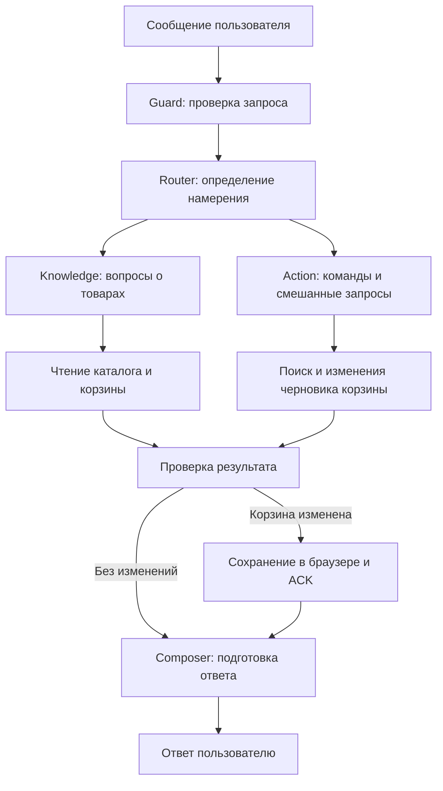

# AI Shopping Assistant

ИИ-ассистент для покупок: ищет товары в каталоге, отвечает на вопросы и управляет корзиной через диалог. Проект показывает полный цикл агентного приложения — от определения намерения и вызова инструментов до сохранения результата и проверки качества в Promptfoo.

В интерфейсе доступны чат, корзина и журнал выполнения с этапами обработки запроса и вызовами инструментов. На странице настроек можно редактировать каталог и профиль ассистента.

> **Скриншот приложения:** чат, корзина и журнал выполнения.

<!-- Добавьте файл docs/screenshots/app.png и замените строку выше на:

-->

## Архитектура

Проект — TypeScript-монорепозиторий с тремя пакетами:

| Пакет              | Назначение                                           | Технологии                                          |
| ------------------ | ---------------------------------------------------- | --------------------------------------------------- |
| `packages/web`     | Интерфейс, состояние пользователя и WebSocket-клиент | Next.js, React, Zustand, vanilla-extract |
| `packages/service` | Сервер, оркестратор ИИ и инструменты                 | Fastify, WebSocket, OpenAI SDK                      |
| `packages/shared`  | Общие контракты и правила работы с корзиной          | Zod, TypeScript                                     |

Браузер обращается к Next.js, который проксирует WebSocket-запросы в Fastify. Сервер выполняет ИИ-workflow и передаёт события для журнала выполнения. Каталог, корзина, настройки и история сохраняются в `localStorage`; сервер работает без базы данных. Ключ OpenAI используется только на сервере.

### ИИ Агент

Оркестратор последовательно вызывает роли с отдельными промптами. Все роли используют модель из `OPENAI_MODEL`.



| Роль          | Ответственность                                                                                                   |
| ------------- | ----------------------------------------------------------------------------------------------------------------- |
| **Guard**     | Проверяет сообщение на спам с учётом контекста диалога.                                                           |
| **Router**    | Различает вопрос, команду, смешанный запрос и обращение вне темы. При неоднозначности запрашивает уточнение.      |
| **Knowledge** | Отвечает по данным каталога; имеет доступ только к инструментам чтения.                                           |
| **Action**    | Находит товары и меняет черновик корзины. В смешанных запросах сначала получает данные, затем выполняет действие. |
| **Composer**  | Выбирает структуру ответа по проверенным товарам и статусу сохранения.                                            |

Инструменты чтения: `search_products`, `get_product`, `get_cart`, `choose_cheapest`. Для изменений доступны `add_to_cart`, `set_cart_quantity`, `remove_from_cart`. Поиск выполняется по ключевым словам и фильтрам; выбор минимальной цены рассчитывается в коде.

Модель выбирает инструменты через function calling и возвращает структурированные результаты. Шлюз инструментов проверяет аргументы через Zod, права роли и лимит вызовов. Прежде чем изменить товар, агент обязан получить его из каталога. Тексты промптов версионируются в [`packages/service/src/ai/prompts/v1`](packages/service/src/ai/prompts/v1).

Названия, цены и характеристики в финальном ответе подставляются из полученных данных каталога. При неоднозначности ассистент задаёт уточняющий вопрос, а при отсутствии характеристик сообщает об этом.

## Оценка качества с Promptfoo

**Promptfoo** подключён через TypeScript SDK. Он запускает сценарии через настоящий оркестратор и шлюз инструментов, собирает результаты и позволяет сравнивать прогоны в локальном интерфейсе.

В наборе **34 сценария**: поиск и фильтрация по цене, выбор самого дешёвого товара, изменения корзины, уточнения, отсутствующие характеристики, пустой каталог, prompt injection и сбои на разных этапах workflow.

Проверки написаны на TypeScript. Они оценивают итоговую корзину, найденные товары, уточнения, коды ошибок и порядок подтверждения сохранения. В отчёт также попадают вызванные инструменты, время выполнения, расход токенов и оценка стоимости для реальной модели.

```sh
# Запуск тестов
yarn eval:live

# Открыть историю и результаты прогонов
yarn eval:view
```

> **Скриншот Promptfoo:** таблица результатов с проверками сценариев.

<!-- Добавьте файл docs/screenshots/promptfoo.png и замените строку выше на:

-->

История Promptfoo хранится локально в `.promptfoo/`, JSON-отчёты — в `tests/evals/results/`. Ошибки выполнения и проваленные проверки завершают команду с ненулевым кодом.

## Запуск

Требуются **Node.js 24+** и **Yarn 4.18.1** (версия закреплена в `package.json`).

```sh
corepack enable
corepack yarn install --immutable
cp .env.example .env
```

Укажите в `.env` значения `OPENAI_API_KEY` и `OPENAI_MODEL`, затем запустите приложение:

```sh
yarn dev
```

Откройте [localhost:3000](http://localhost:3000). Fastify запускается на порту `3001`. Модель должна поддерживать structured outputs, function calling и `reasoning.effort: "none"`, который задан в адаптере.

Для знакомства без API-ключа:

```sh
yarn dev:fake
```

Этот режим использует детерминированный парсер английских запросов и доступен для разработки и тестов. Примеры:

- `Find a lamp under $50 and add the cheapest one.`
- `Add two of the blue mugs.`
- `Remove one blue mug.`

Остальные параметры сервера и необязательных Telegram-уведомлений перечислены в [`.env.example`](.env.example).

## Проверки и сборка

```sh
# Типы, линтер, unit/integration-тесты и сборка
yarn check

# Установить браузер для E2E-тестов
yarn playwright install chromium

# Браузерные сценарии
yarn test:e2e

# Запустить собранное приложение
yarn start
```
