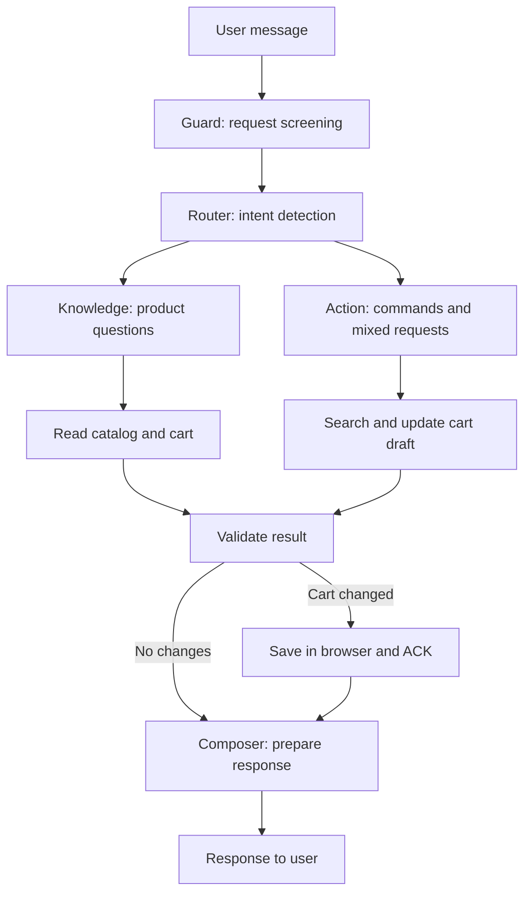

# AI Agent Showcase

An AI shopping assistant that searches the catalog, answers product questions, and manages a cart through conversation. The project demonstrates the full lifecycle of an agent application — from intent detection and tool calls to saving results and evaluating quality with Promptfoo.

The interface includes a chat, a shopping cart, and an execution log showing request stages and tool calls. The settings page lets you edit the catalog and the assistant's profile.


## Architecture

The project is a TypeScript monorepo with three packages:

| Package            | Purpose                                     | Technologies                             |
| ------------------ | ------------------------------------------- | ---------------------------------------- |
| `packages/web`     | Interface, user state, and WebSocket client | Next.js, React, Zustand, vanilla-extract |
| `packages/service` | Server, AI orchestrator, and tools          | Fastify, WebSocket, OpenAI SDK           |
| `packages/shared`  | Shared contracts and cart rules             | Zod, TypeScript                          |

The browser connects to Next.js, which proxies WebSocket requests to Fastify. The server runs the AI workflow and sends events to the execution log. The catalog, cart, settings, and history are stored in `localStorage`; the server has no database. The OpenAI key is used only on the server.

### AI Agent

The orchestrator invokes roles sequentially, each with its own prompt. All roles use the model configured in `OPENAI_MODEL`.



| Role          | Responsibility                                                                                                                     |
| ------------- | ---------------------------------------------------------------------------------------------------------------------------------- |
| **Guard**     | Screens messages for spam using conversation context.                                                                              |
| **Router**    | Distinguishes questions, commands, mixed requests, and out-of-scope messages. Requests clarification when the intent is ambiguous. |
| **Knowledge** | Answers using catalog data; has access only to read tools.                                                                         |
| **Action**    | Finds products and updates a cart draft. For mixed requests, retrieves data before taking action.                                  |
| **Composer**  | Selects the response structure based on verified products and persistence status.                                                  |

Read tools: `search_products`, `get_product`, `get_cart`, `choose_cheapest`. Cart changes use `add_to_cart`, `set_cart_quantity`, and `remove_from_cart`. Search uses keywords and filters; the lowest-price selection is calculated in code.

The model selects tools through function calling and returns structured results. The tool gateway validates arguments with Zod, enforces role permissions, and limits tool calls. Before changing a product's cart quantity, the agent must retrieve it from the catalog. Prompts are versioned in [`packages/service/src/ai/prompts/v1`](packages/service/src/ai/prompts/v1).

Product names, prices, and specifications in the final response come from retrieved catalog data. The assistant asks for clarification when a request is ambiguous and discloses missing specifications.

## Quality Evaluation with Promptfoo

**Promptfoo** is integrated through its TypeScript SDK. It runs scenarios through the actual orchestrator and tool gateway, collects results, and lets you compare runs in a local interface.

The suite contains **34 scenarios** covering search and price filtering, lowest-price selection, cart changes, clarifications, missing specifications, an empty catalog, prompt injection, and failures at different workflow stages.

Assertions are written in TypeScript. They check the final cart, retrieved products, clarifications, error codes, and the order of persistence confirmations. Reports also include tool calls, execution time, token usage, and estimated cost for the real model.

```sh
# Run evaluations
yarn eval:live

# Open run history and results
yarn eval:view
```


Promptfoo history is stored locally in `.promptfoo/`, and JSON reports are saved to `tests/evals/results/`. Execution errors and failed assertions cause the command to exit with a nonzero code.

## Getting Started

Requires **Node.js 24+** and **Yarn 4.18.1** (pinned in `package.json`).

```sh
corepack enable
corepack yarn install --immutable
cp .env.example .env
```

Set `OPENAI_API_KEY` and `OPENAI_MODEL` in `.env`, then start the application:

```sh
yarn dev
```

Open [localhost:3000](http://localhost:3000). Fastify runs on port `3001`. The model must support structured outputs, function calling, and `reasoning.effort: "none"`, which is set in the adapter.

To try the application without an API key:

```sh
yarn dev:fake
```

This mode uses a deterministic parser for English requests and is available for development and testing. Examples:

- `Find a lamp under $50 and add the cheapest one.`
- `Add two of the blue mugs.`
- `Remove one blue mug.`

Other server settings and optional Telegram notification settings are listed in [`.env.example`](.env.example).

## Checks and Build

```sh
# Type checking, linting, unit/integration tests, and build
yarn check

# Install the browser for E2E tests
yarn playwright install chromium

# Browser scenarios
yarn test:e2e

# Start the built application
yarn start
```
