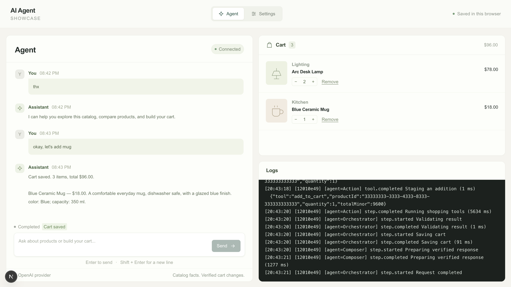
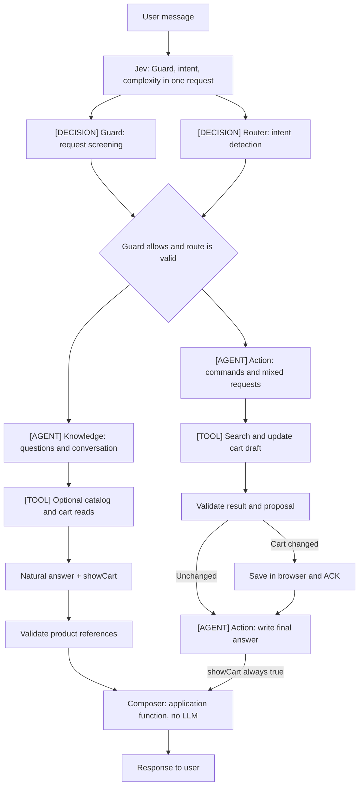
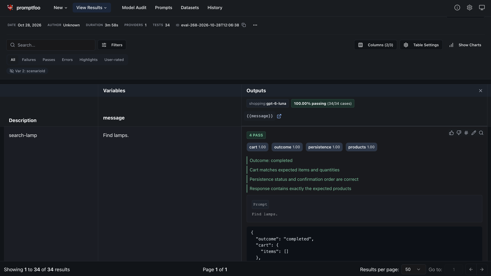

# AI Agent Showcase

An AI shopping assistant that searches the catalog, answers product questions, and manages a cart through conversation. The project demonstrates the full lifecycle of an agent application — from intent detection and tool calls to saving results and evaluating quality with Promptfoo.

The interface includes a chat, a shopping cart, and an execution log showing request stages and tool calls. The settings page lets you edit the catalog and the assistant's profile.



## Architecture

The project is a TypeScript monorepo with three packages:

| Package            | Purpose                                     | Technologies                                        |
| ------------------ | ------------------------------------------- | --------------------------------------------------- |
| `packages/web`     | Interface, user state, and WebSocket client | Next.js, React, Zustand, vanilla-extract            |
| `packages/service` | Server, AI orchestrator, and tools          | Fastify, WebSocket, LangGraph, LangChain OpenRouter |
| `packages/shared`  | Shared contracts and cart rules             | Zod, TypeScript                                     |

The browser connects to Next.js, which proxies WebSocket requests to Fastify. The server runs the AI workflow and sends events to the execution log. The catalog, cart, settings, and history are stored in `localStorage`; the server has no database. The OpenRouter key is used only on the server.

### AI Agent

LangGraph `StateGraph` controls checks, routing, Knowledge/Action, validation, persistence, and response nodes. With `MODEL_FAST` configured, a single [OpenRouter Decisions API](https://openrouter.ai/docs/guides/community/jev) request asks the decision model (Jev) for Guard, intent, and complexity. Low-confidence Guard or intent decisions, or an uncertain Guard, are rechecked by `MODEL` before any tools run. Low confidence only in complexity directly selects `MODEL` for execution without a separate verification call. Trusted spam stops immediately. `SIMPLE` requests execute on `MODEL_SIMPLE` when configured; `COMPLEX` and rechecked requests execute on `MODEL`. Final Action responses use `MODEL_SIMPLE` (or `MODEL` when omitted), after the persistence ACK. Jev cannot generate text: for a clarification decision, Knowledge receives only read tools and must write a clarification question. Composer is a deterministic application function and does not call a model.

Guard uncertainty and missing request information are separate decisions: an `UNCERTAIN` Guard does not overwrite a verified `QUESTION` route. Low confidence on a read-only question does not force a clarification; uncertain cart commands remain read-only. Chat-model checks and execution receive the current request as the final user message, after a JSON envelope with background history and cart state.

Without `MODEL_FAST`, Guard and Router retain the parallel chat-model path using `MODEL`. Model and tool calls share request-wide limits, including decision verification. Usage is recorded by model.

With Decisions enabled, Guard and Router share one assessment. Their step durations include both the Decisions request and any main-model verification, so do not add these two durations together. Completion details report `decisionMs`, `verificationMs` (zero when skipped), and `verificationUsed`; measurements include network latency and response parsing. `guardConfidence`, `routeConfidence`, `complexityConfidence`, and `decisionThreshold` explain the confidence check. `verificationReasons` lists `guard_uncertain`, `guard_confidence`, or `route_confidence`; an empty list means no verification. `decisionRoute` is Jev’s original intent, while `route` is the final intent after any verification.



`[DECISION]` marks a typed Jev judgment; `[AGENT]` marks a generative LLM agent; `[TOOL]` marks a group of tools available to the agent. Unmarked processing nodes run in application code, including Composer.

| Role          | Responsibility                                                                                                                                |
| ------------- | --------------------------------------------------------------------------------------------------------------------------------------------- |
| **Guard**     | Screens messages for spam using conversation context.                                                                                         |
| **Router**    | Distinguishes questions, commands, mixed requests, and out-of-scope messages. Greetings and capability questions go to Knowledge.             |
| **Knowledge** | Writes a natural-language answer, optionally using read tools. Chooses whether the answer should include the cart.                            |
| **Action**    | Retrieves products, stages changes, and answers mixed requests. Writes the final response after validation and, for changes, persistence ACK. |
| **Composer**  | Validates and forwards the text and optionally attaches a cart view. Runs in application code with no model call.                             |

Read tools: `search_products`, `get_product`, `get_cart`, `choose_cheapest`. Cart changes use `add_to_cart`, `set_cart_quantity`, and `remove_from_cart`. Search uses keywords and filters; the lowest-price selection is calculated in code.

The model selects tools through function calling and submits final results through `finish_response`, including greetings. Valid JSON wrapped in a Markdown code block is accepted as a compatibility fallback. If the final format is still invalid, the graph makes at most one native JSON Schema correction call without shopping tools, using the same selected model and request budget. Product-reference and cart validation still run afterward. The tool gateway validates arguments with Zod, enforces role permissions, and limits tool calls. Before changing a product's cart quantity, the agent must retrieve it from the catalog. Prompts are versioned in [`packages/service/src/ai/prompts/v1`](packages/service/src/ai/prompts/v1).

Agents are instructed to ground their prose in retrieved data, answer the actual question, and disclose missing specifications. The orchestrator validates referenced product IDs, tool permissions, and cart proposals; it does not mechanically verify every claim in free-form text. Response-quality evaluations therefore check answer content as well as execution. Price minima computed by `choose_cheapest` apply to the retrieved candidate set; the current search returns at most ten matches, so a partial result must not be described as a global minimum.

## Quality Evaluation with Promptfoo

**Promptfoo** is integrated through its TypeScript SDK. It runs scenarios through the actual orchestrator and tool gateway, collects results, and lets you compare runs in a local interface.

The suite contains **43 scenarios** covering search and price filtering, lowest-price selection, cart changes, clarifications, missing specifications, an empty catalog, prompt injection, failures at different workflow stages, text-only greetings and capability answers, focused attribute questions, cart visibility, and conversational price comparisons.

Assertions are written in TypeScript. They check the final cart, referenced products, answer content, cart visibility, unnecessary tool calls, clarifications, error codes, and the order of persistence confirmations. Unit and SDK integration tests also verify that questions skip the former Composer model call and Action cannot hide the cart. Browser tests cover text-only answers and cart snapshots across edits and reloads. Reports also include tool calls, execution time, token usage, and estimated cost for the real model.

```sh
# Run evaluations
yarn eval:live

# Open run history and results
yarn eval:view
```



Promptfoo history is stored locally in `.promptfoo/`, and JSON reports are saved to `tests/evals/results/`. Execution errors and failed assertions cause the command to exit with a nonzero code.

## Getting Started

Requires **Node.js 24+** and **Yarn 4.18.1** (pinned in `package.json`).

```sh
corepack enable
corepack yarn install --immutable
cp .env.example .env
```

Set `OPENROUTER_API_KEY` and `MODEL` (the main generative OpenRouter model ID) in `.env`. The service and live evaluations load `.env` automatically. All models use the same OpenRouter key.

| Variable                        | Purpose                                                                                                                                                                                                    |
| ------------------------------- | ---------------------------------------------------------------------------------------------------------------------------------------------------------------------------------------------------------- |
| `MODEL`                         | Required main chat model for complex requests and decision verification.                                                                                                                                   |
| `MODEL_FAST`                    | Optional decision model, e.g. `typesafe/jev-1.14`, for Guard, intent, and complexity. Uses Decisions API, never Chat Completions.                                                                          |
| `MODEL_SIMPLE`                  | Optional generative chat model for simple requests and final Action responses. Defaults to `MODEL`; do not put Jev here.                                                                                   |
| `DECISION_CONFIDENCE_THRESHOLD` | Minimum confidence and selected-choice probability, default `0.7`. Guard/intent below the threshold trigger verification; uncertain complexity selects `MODEL` directly. Tune against your evaluation set. |

The example `.env` enables Jev. Each chat model must support tool calling and JSON Schema structured output; requests require compatible provider endpoints. `LLM_PROVIDER=openrouter` is the default. Then start the application:

```sh
yarn dev
```

Open [localhost:3000](http://localhost:3000). Fastify runs on port `3001`. Chat models must support structured outputs and function calling.

To try the application without an API key:

```sh
yarn dev:fake
```

This mode uses a deterministic parser for English requests and is available for development and testing. Examples:

- `Find a lamp under $50 and add the cheapest one.`
- `Add two of the blue mugs.`
- `Remove one blue mug.`

Other server settings and optional Telegram notification settings are listed in [`.env.example`](.env.example).

## Checks and Build

```sh
# Type checking, linting, unit/integration tests, and build
yarn check

# Install the browser for E2E tests
yarn playwright install chromium

# Browser scenarios
yarn test:e2e

# Start the built application
yarn start
```
